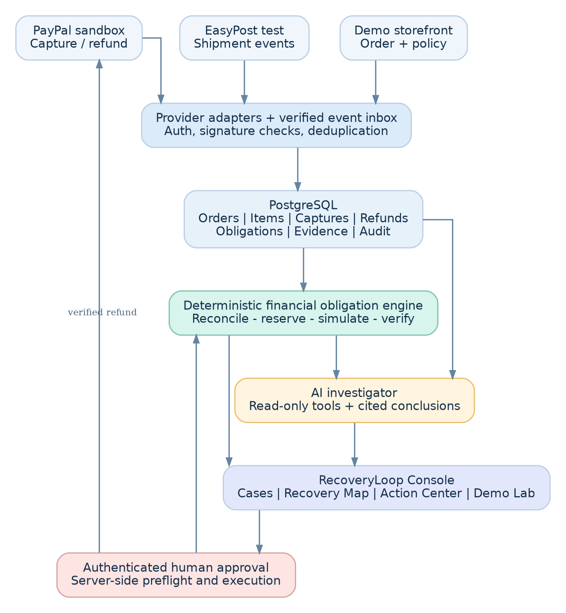

# RecoveryLoop AI

[](https://github.com/recoveryloop-ai/recoveryloop-ai/actions/workflows/ci.yml)
[](https://recoveryloop-ai.vercel.app)
[](LICENSE)

RecoveryLoop AI turns fragmented payment, shipment, policy and refund evidence into an auditable customer obligation before money moves. The ResolutionGraph engine keeps deterministic financial rules authoritative while Z.ai GLM 5.3 explains evidence through a strictly read-only tool boundary.

**Live judge demo:** https://recoveryloop-ai.vercel.app
**Release state:** S0–S7 complete; S8 technical release gates verified. Public YouTube publication and final Devpost submission remain owner-controlled actions.

## Judge path

No account is required:

1. Open the [public production app](https://recoveryloop-ai.vercel.app) and choose **Explore live demo**.
2. Open case `RG-2048` and inspect the cited investigation.
3. Follow the Recovery Map: `$250.00` captured, `$100.00` customer obligation, `$100.00` simulated remedy.
4. In Demo Lab, choose **Already refunded**. The isolated synthetic overlay changes the additional remedy to `$0.00` with `REFUND_ALREADY_SETTLED`.
5. Reset safely. Only the current anonymous overlay is deleted; canonical provider records do not change.
6. Open the redacted certificate for the separate authenticated PayPal Sandbox action.

Public visitors can inspect and simulate, but cannot create, approve, capture, execute or reconcile provider money actions.

## What is real, test-mode and synthetic

| Evidence | Provenance | Meaning |
|---|---|---|
| `$250.00` capture and `$100.00` partial refund | PayPal Sandbox, independently read back | Real sandbox provider records; no live funds |
| Return-to-sender carrier events | EasyPost test tracker | Provider test events, not a commercial delivery |
| Item-to-shipment mapping and judge overlays | Explicitly `SYNTHETIC` | Safe demo evidence only |
| Investigation narrative | Z.ai GLM 5.3 or explicit rules fallback | Explanatory; never determines executable amounts |
| Refund amount and duplicate block | Deterministic policy v1 | Sole financial authority |

RecoveryLoop does not claim recovered carrier cash, live merchant deployment, automated carrier-claim submission or production PayPal access.

## Architecture and safety



- Next.js 16 App Router and TypeScript modular monolith on Vercel.
- Supabase PostgreSQL with Drizzle migrations; every public table has RLS and no direct `anon`/`authenticated` grants.
- Supabase Auth checks the server-verified operator identity and trusted `app_metadata` on every money route.
- Integer-cent USD arithmetic, immutable evidence/policy snapshots and semantic duplicate guards.
- Stable PayPal request IDs, transaction reservations and independent provider GET verification.
- Signed `HttpOnly`, `SameSite=Lax`, HTTPS-only judge cookies; only token hashes are stored.
- Allowlisted session overlays with 45-minute TTL, atomic request cap and session-scoped reset.
- Z.ai uses eight scoped read-only tools, strict output validation, stored evidence IDs and a durable rules fallback.

The [master blueprint](docs/MASTER_TECHNICAL_BLUEPRINT.md), [judge contract](docs/JUDGE_DEMO_CONTRACT.md), [decisions](docs/DECISIONS.md) and sprint reports document the complete design and observed evidence.

## Local setup

Requirements: Node.js 22+, npm and a PostgreSQL/Supabase connection. Provider credentials are required only for the corresponding sandbox/test integration.

```bash
git clone https://github.com/recoveryloop-ai/recoveryloop-ai.git
cd recoveryloop-ai
npm ci
npm run env:init
```

Edit the generated, Git-ignored `.env.local`. Never commit or share it. Keep:

```dotenv
DEMO_MODE=true
PAYPAL_ENV=sandbox
AI_PROVIDER=zai
ZAI_MODEL=glm-5.3
```

Generate `DEMO_SESSION_SIGNING_SECRET` from at least 32 random bytes. Use a Supabase publishable key only in `NEXT_PUBLIC_SUPABASE_PUBLISHABLE_KEY`; secret keys remain server-only. See [.env.example](.env.example) and [provider setup](docs/PROVIDER_SETUP.md) for the full inventory.

Initialize the database and run the app:

```bash
npm run db:migrate
npm run db:seed:s1
npm run s3:ingest:f02
npm run s4:reconcile
npm run dev
```

The repository never includes provider credentials, operator passwords, sandbox buyer identities, customer PII or `.env.local`.

## Verification

```bash
npm run lint
npm run typecheck
npm test
npm run build
npm run test:e2e
npm run db:verify:s1
npm run db:verify:s2
npm run db:verify:s3
npm run db:verify:s4
npm run db:verify:s5
npm run db:verify:s6
npm run db:verify:s7
npm run release:verify
```

`release:verify` is non-mutating with respect to providers. It checks the public HTTPS app, six routes, signed-cookie attributes, isolated overlay/reset behavior, redacted certificate, public GitHub README/license and direct anonymous denial on money routes.

Current verified evidence:

- 99 unit/contract tests.
- 24 local desktop/mobile/operator E2E tests.
- All database verifiers S1–S7 pass; 24 RLS tables and zero public table grants.
- Exactly one GET-verified `$100.00` PayPal Sandbox refund against the `$250.00` capture; a duplicate proposal is blocked before network.
- Public session isolation and reset preserve the canonical financial-ledger fingerprint.
- `npm audit --audit-level=high`: zero vulnerabilities at the S8 release checkpoint.

Public CI intentionally has no database or provider secrets. Secret-dependent browser checks skip there and run locally/against production with the configured release environment.

## Provider boundaries

- `PAYPAL_ENV=live` is rejected whenever `DEMO_MODE=true`.
- `smoke:paypal` creates only an unapproved, uncaptured `$1.00` sandbox order; it never satisfies the verified refund proof.
- `s6:execute` is an operator-authenticated proof command and is idempotent after completion. Do not run it casually.
- EasyPost uses test mode only.
- The `openai` npm package is used as an OpenAI-compatible client for the configured Z.ai endpoint; OpenAI services are not used.

## Release materials

- [S8 submission checklist](docs/SUBMISSION_CHECKLIST.md)
- [Demo video script](docs/DEMO_SCRIPT.md)
- [Devpost submission draft](docs/DEVPOST_SUBMISSION.md)
- [S8 implementation and release report](docs/S8_IMPLEMENTATION_REPORT.md)
- [Collaborator onboarding](docs/COLLABORATOR_ONBOARDING.md)

## License

Released under the [MIT License](LICENSE). Copyright © 2026 RecoveryLoop AI contributors.
