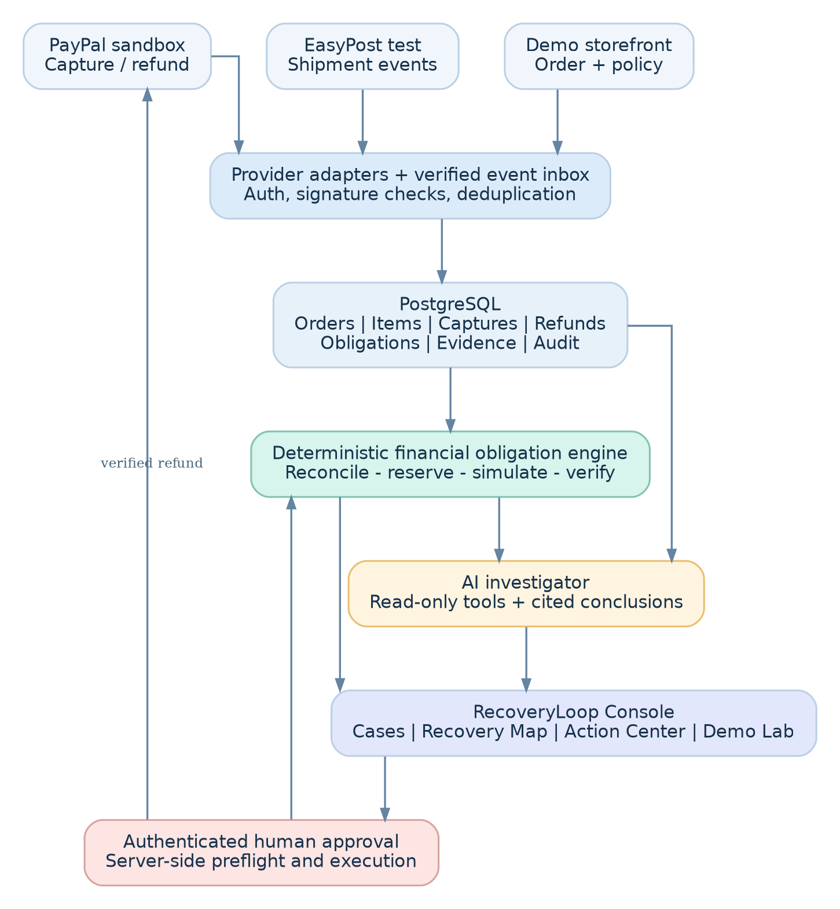
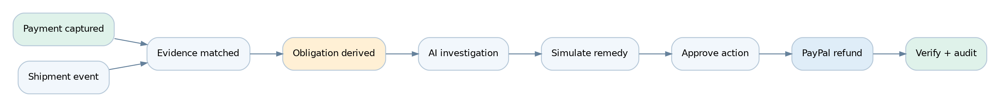
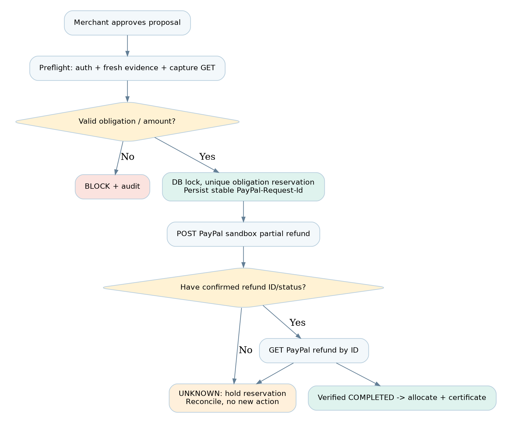

# RecoveryLoop AI
## Technical Product Blueprint, Architecture, Workflow Contracts, QA Strategy and Codex Sprint Plan

**Version:** 1.0 - Owner-approved hackathon implementation baseline  
**Prepared:** 31 October 2026 (Asia/Karachi)  
**Product:** RecoveryLoop AI | Engine: ResolutionGraph  
**Competition:** PayPal AI Hackathon 2026  
**Build mode:** solo developer with AI coding assistance; 40-70 hours total  
**Target submission:** 12 November 2026 at 18:00 PKT internally (the official close is 13 November 2026 at 01:00 PKT)  
**Environment:** sandbox and synthetic data ONLY; no production funds, no real customer data.

> **Approved on 31 October 2026.** The owner has approved the RecoveryLoop AI name, electronics/accessories demo vertical, USD and one merchant, OpenAI API, and an interactive public Vercel demo. The owner will provision PayPal Developer/Sandbox and EasyPost; Supabase, Vercel and AI-provider access are already available. These are approved implementation decisions, not proof that external API access has been tested. This remains a sandbox-only prototype, not a production financial service.

> **Owner override, 1 November 2026:** ADR-015 supersedes OpenAI with the Z.ai standard Model API and `glm-5.3`. In this v1.0 blueprint, legacy references to “OpenAI” mean the provider-neutral AI investigator contract now implemented with Z.ai GLM. All read-only tool, evidence validation, deterministic-money, budget, fallback and server-only secret constraints remain unchanged. ADR-016 permits an explicitly synthetic mock PayPal adapter for development; it does not satisfy the real PayPal sandbox gates.

### Document navigation

- **Strategy and decisions:** Sections 1-2 - problem, differentiators, competition requirements and owner approvals.
- **Architecture and experience:** Sections 3-4 - system components, trust boundaries, tabs and screen contracts.
- **Data and integrations:** Sections 5-6 - PostgreSQL entities, accounting invariants, PayPal and EasyPost interfaces.
- **Workflow and AI:** Sections 7-9 - ten end-to-end workflows, agent tools, safety and API states.
- **Quality and engineering:** Sections 10-11 - test matrix, security, repo layout and coding conventions.
- **Execution and submission:** Sections 12-18 - nine sprints, Codex instructions, demo storyboard, risks, sources, and signed-off public-demo architecture.

---

# 1. Product charter and competition strategy

### 1.1 Problem

One failed ecommerce order can generate multiple inconsistent states: a successful PayPal capture, a partially fulfilled store order, a carrier delivery exception, a refund already completed in PayPal but not recorded by support, a duplicate refund request, and a possible carrier claim. Existing tools often view each slice independently. The merchant lacks a reliable *order-level financial obligation view*, leading to duplicated work, unjustified payouts, unresolved customer obligations and missed recovery opportunities.

**User:** one merchant operator who handles ecommerce fulfillment and payment exceptions. The hackathon demo supports one seeded merchant; schema is multi-tenant-ready but onboarding is out of scope.

**Job to be done:** tell me what happened to this order, what the customer is owed under our documented policy, what money has already moved, what evidence is missing, which actions are safe, and what actually happened after I approved an action.

### 1.2 Product promise

**Investigate -> Reconcile -> Simulate -> Approve -> Execute -> Verify -> Audit.**

RecoveryLoop combines:

1. **Financial Obligation Graph:** trace each order item and shipping charge to the PayPal capture, shipment events, policy obligation, refunds and any open dispute/recovery case.
2. **AI Case Investigator:** use controlled read-only tools to explain discrepancies with record-level evidence references and explicit unknowns.
3. **Counterfactual Resolution Simulator:** compare allowed remedies and the monetary effects of proposed actions; the LLM is not the calculator.
4. **Merchant Action Center:** present approvals with a proposed amount, affected obligation, original evidence snapshot and predicted effect.
5. **Verified Resolution Certificate:** immutable-ish append-only audit trail of action authorization, request, PayPal IDs, latest status and residual obligations.
6. **Recovery opportunity queue:** prepare carrier evidence bundles for manual review; do NOT promise automated claim submission or carrier reimbursement.

### 1.3 Differentiation and honesty

The product is not positioned as the first refund automation, first tracking dashboard, or first dispute copilot. Its precise competitive thesis is **order-item-level financial responsibility across payments and fulfillment, with a counterfactual, safety-enforced action loop and independently verifiable results**. The initial demo tests this thesis; it does not establish global originality or actual financial ROI.

### 1.4 Official competition constraints [R1]

- Stage 1 pass/fail: meaningful PayPal developer platform and AI integration; working, non-trivial implementation.
- Equal judging dimensions: technical implementation, design, potential impact, innovation, presentation.
- Public open-source repository with a license and complete setup instructions.
- Working demo hosted or reproducible locally; optional judge credentials.
- Public YouTube video **under 3 minutes**.
- Project and testing access kept available through the judging window.
- Deadline: Nov 12, 2026, noon PST = Nov 13, 2026 at 01:00 PKT. Our internal completion gate is Nov 12 at 18:00 PKT.
- Sandbox access in Pakistan is not guaranteed; if signup is unavailable, ask organizers through official Discord [R2]. Do not use false location or borrowed identities.

### 1.5 Demonstration thesis

A $250 PayPal sandbox purchase has two items: A ($150) delivered, B ($100) returned to sender. The operator approves a $100 refund for B. A real PayPal sandbox refund ID is displayed and re-read; then a second refund request for the *same underlying obligation* is blocked by the policy/state engine. The AI traces the evidence and proposes a separate carrier-claim evidence checklist without claiming that a carrier will pay.

**Success:** real capture + real partial refund, read-back verification, duplicate block that persists across refreshes, evidence-linked explanation, a usable UI, replayable tests and a convincing <= 2:55 video.

**Failure conditions:** static mock pretending to be connected; fabricated PayPal/courier results; AI able to directly call refunds; incorrect money arithmetic; duplicate refunds due to retries; inability to reproduce or review the demo.

---

# 2. Owner-approved decisions, constraints and non-goals

All choices in this section were confirmed on **31 October 2026**, except model identifier and actual provider credential availability, which are implementation-time checks. Do not repeatedly ask the owner to reconfirm these decisions.

| ID | Decision | Approved implementation | Invariant / reason |
|:--|:--|:--|:--|
| ADR-001 | Product identity | **RecoveryLoop AI**, powered by the ResolutionGraph engine | Working brand approved; no trademark clearance asserted. |
| ADR-002 | Merchant vision and demo | Platform design generalizes to online merchants; MVP is **one electronics/accessories demonstration merchant** | Real Shopify multi-tenant OAuth is not required. |
| ADR-003 | Currency | **USD only**, all money as integer cents | No mixed-currency arithmetic. |
| ADR-004 | Buyer commerce | Functional small electronics demo storefront with items, fulfillment promises, versioned policy | A self-contained route demonstrates the order journey. |
| ADR-005 | PayPal | **PayPal sandbox Orders/Captures/Refunds**, created/provisioned by owner | Legitimate signup is unverified until S0; never claim real money. |
| ADR-006 | Courier | **EasyPost test mode** with known tracker events plus labeled synthetic overlays | Owner will create account; test parcel statuses are not real shipping proof. |
| ADR-007 | AI | **OpenAI API**, structured outputs and controlled read-only tools | Choose a currently available compatible model at S0; no AI money authority. |
| ADR-008 | Database | Existing **Supabase PostgreSQL**, migrations via Drizzle | Transactional reservations, consistent relations. |
| ADR-009 | Hosting | Existing **Vercel** account; working public production demo | Public app must be navigable without a Vercel-team account. |
| ADR-010 | Judge access | **Interactive public judge workspace with per-session synthetic changes; protected operator workspace for PayPal writes** | Public judges can interact but cannot change provider-backed ledger or execute refunds. |
| ADR-011 | Merchant operator login | Supabase Auth or equivalent server-verified identity, allowlisted operator | Never authenticate money actions with a shared browser-side flag. |
| ADR-012 | Disputes and claims | Synthetic dispute read; carrier claim evidence preparation only | No promise of provider dispute/claim submission or recovery. |
| ADR-013 | Action authority | Deterministic preflight + human approval + PayPal read-back | All approved refunds are server-only, sandbox-only and audited. |
| ADR-014 | Release/availability | Hosted URL, public source/license, demo video <3 min, graceful degraded AI | Maintain demo accessibility during judging. |

**Availability status as of sign-off**: PayPal developer account = **TO BE CREATED BY OWNER**; EasyPost test account = **TO BE CREATED BY OWNER**; Supabase = owner has; Vercel = owner has; OpenAI API = selected/owner has access, but model/key/quotas not yet technically tested. Do not place keys in this document or chat.

### 2.1 Non-goals and delivery boundaries

**Excluded:** onboarding unknown merchants, production payments/refunds, unrestricted public checkout, fully automatic monetary actions, real DHL/FedEx/UPS carrier contracts, automatically submitted/paid recovery claims, automatic dispute arbitration, mobile apps and tax accounting. A **generalizable integration architecture** is in scope; full multi-merchant integrations are not.

**Definition of public live demo:** judges can open the production Vercel URL, navigate all six core tabs and case details, change **synthetic evidence in an isolated judge session**, rerun deterministic rules and bounded OpenAI investigations, inspect proposed remedies and view redacted provider-verified receipts. Judges do **not** get live API write permissions to PayPal, nor credentials to an operator account. A verified PayPal sandbox capture/refund must still be executed by the operator and shown in the video and a read-only proof panel.

**Owner to-do before S0:** create PayPal Developer/Sandbox and EasyPost test accounts, keep credentials in local `.env.local` and Vercel server environment, verify use of real country/identity, and ensure OpenAI API credits/quota. The coding agent must report exact API smoke-test results, never infer access from account creation alone.

---

# 3. System architecture and boundaries



### 3.1 Design principle: modular monolith

Use a single Next.js repository and deployment; separate modules by domain interfaces, not independently deployed microservices. The hackathon has no need for Kafka, Kubernetes or an elaborate multi-agent framework. PostgreSQL transactions and a durable outbox-style table are enough for low-volume demo workflows.

**Bounded modules:**

- `commerce`: demo storefront, orders, order items, shipping promises, policy snapshots.
- `payments`: PayPal OAuth, Orders v2, capture records, refund requests and status read-back.
- `logistics`: EasyPost trackers, normalized carrier events, order-item-to-shipment mapping.
- `obligations`: policy-derived refund obligations, satisfaction and remaining liabilities.
- `graph`: typed nodes/edges representing evidence and financial relationships; implemented using relational tables, no separate graph database.
- `investigation`: detection rules, evidence retrieval tools, AI explanation and citations.
- `simulation`: deterministic policy and money calculations for possible actions.
- `actions`: approval, reservation, execution, reconciliation and audit.
- `recovery`: carrier claim *preparation*, missing-evidence checklist and follow-up status.
- `demo-lab`: seeded scenarios and safe evidence toggles; reset only through protected endpoint.

### 3.2 Data trust tiers

| Tier | Source | Treatment |
|:--|:--|:--|
| `PROVIDER_VERIFIED` | Server-to-PayPal API read-back, signed and deduplicated webhook | High confidence about provider-reported state, subject to API eventual consistency. |
| `PROVIDER_TEST` | EasyPost test API / signed test webhook | Verified provider test response, not a real-world shipment. |
| `MERCHANT_ATTESTED` | Merchant-defined policies, CSV/JSON orders | Trusted for merchant promise only after configuration; not independent delivery proof. |
| `SYNTHETIC` | Generated test fixtures and challenge-mode mutations | Educational demonstration only; never described as real courier evidence. |
| `AI_DERIVED` | LLM summaries or hypotheses | Non-authoritative until checked against deterministic rules and records. |

Every evidence record carries `source_tier`, `provider`, `external_id`, `observed_at`, `recorded_at`, `raw_payload_hash`, and `synthetic_flag`. User-facing labels cannot hide test or synthetic provenance.

### 3.3 Runtime trust boundaries

- Browser contains a public PayPal client ID **only** and no API secret.
- Server-side payment adapter owns OAuth token and PayPal client secret.
- Server-side logistics adapter owns EasyPost API key and webhook HMAC secret.
- Server-side AI adapter owns model API key and receives redacted, minimal evidence.
- Database row ownership is enforced by merchant scope; no unchecked `merchant_id` accepted from browser.
- Payment action endpoint requires authenticated operator + fresh `approved` record; demo viewer cannot execute.
- The LLM may call **read-only tools only**. Financial mutations originate from policy-validated backend action handlers.

---

# 4. Functional product UX / information architecture

### 4.1 Primary navigation (6 tabs, plus settings)

| Tab / route | Core components | User can do | Definition of done |
|:--|:--|:--|:--|
| **Command Center** `/app` | KPIs, case queue, financial snapshot, activity stream | Open most important unresolved case | Figures derive from DB and show demo-source labels. |
| **Cases** `/app/cases` | Filterable list, risk/priority, state, money at stake | Open a case; run investigation | No AI-generated amount is shown as verified cash. |
| **Orders** `/app/orders` | Order list, item fulfillment timeline, PayPal/courier IDs | Inspect item/payment/shipping facts | Full provenance and event history. |
| **Recovery Map** `/app/recovery` | Item obligations, payment/shipments graph, resolution simulator | Compare remedies and financial consequences | Values recomputed by backend. |
| **Action Center** `/app/actions` | Proposed actions, approve/reject, execution receipts | Authorize safe sandbox action | Two-step approval and read-back. |
| **Demo Lab** `/app/demo` | Seed scenario selector, evidence toggles, test replay | Inject safe synthetic evidence; compare outcomes | All synthetic changes visibly labeled; isolated from provider-verified facts. |
| **Settings** `/app/settings` | Providers, health checks, merchant policy, demo access | Validate configuration, test connectors | Never displays API secrets. |

Audit log and Recovery Certificate are **case detail subpanels**, not separate main tabs. A dedicated storefront lives at `/store` (separate minimal buyer journey).

### 4.2 Screen specifications

**Command Center:** navigation sidebar; top filter `All | Needs review | In progress | Resolved`; four KPI tiles: `Verified captured`, `Verified refunded`, `Open proposed actions`, `Illustrative loss exposure`. The last two must be labeled estimates/not settled money. Central stacked case list with severity, evidence count, recommended action and last provider sync. Right panel “What needs attention?” with 3 prioritized cases.

**Cases list:** case ID, order ID, issue classification, source, amount at issue, last update, proposed action, current workflow status; sorting and detail drawer. Use AG Grid only if it clearly improves exploration and does not consume integration-critical sprint time.

**Case detail:** (a) financial summary (b) vertical event timeline (c) evidence list with trust badges (d) AI investigation with citations (e) proposed remedies (f) existing action/audit history (g) certificate export/print.

**Orders:** `Order > Item > Shipment` tree; order total with items/tax/shipping as separate components; PayPal ID/capture ID; status differences clearly labeled by provider. Order detail must expose exact item-to-shipment mapping instead of joining solely on a tracking number.

**Recovery Map:** left rail of nodes and links (order, item, capture, refund, obligation, shipment, claim); main panel with `captured`, `completed refunds`, `pending refunds`, `customer obligation remaining`, `carrier recovery candidate` (not guaranteed); right simulator with legal/safe options. “Source of number” expands formula and evidence records.

**Action Center:** proposal card includes amount, affected obligation, policy version, evidence snapshot time, approvals, preflight rules, and whether the action is `PROPOSED`, `APPROVED`, `EXECUTING`, `UNKNOWN`, `COMPLETED`, `FAILED`, or `REJECTED`. Confirm dialog uses a phrase such as `REFUND $100.00 IN SANDBOX` and a record of the confirming operator; no AI one-click refund.

**Demo Lab:** public judge can choose Scenario 1 partial loss, Scenario 2 duplicate refund, or Scenario 3 contradictory delivery proof; alter only allowlisted synthetic fields in a per-session overlay; rerun engine and bounded AI; compare before/after decisions, evidence IDs and money changes. Show `SANDBOX RECEIPT` separately from `SYNTHETIC TEST EVIDENCE`. `Reset demo` clears judge overlay only; it **never** tries to reverse provider refunds, delete genuine PayPal capture IDs or reset the canonical ledger.

**Public launch experience:** `/` offers `Explore live demo` (anonymous and interactive), `View verified PayPal proof` (redacted, read-only), and `Operator sign in` (authenticated). A public judge should reach the primary case in two clicks with no signup. Navigation is real and populated, not a static Figma page. Public actions are simulated inside a sandboxed per-visitor workspace; labels and API route permissions make this explicit. Operator-only refund execution is not exposed through this public flow.

**Design tokens:** deep navy/ink, soft neutral surfaces, one electric blue accent, semantic orange/red/green only for statuses. Modern B2B operations aesthetic, type size >= 13px for data, WCAG-minded contrast, responsive desktop-first. No fake charts or invented KPIs. Use restrained animation only to emphasize the decision transition.

---

# 5. Domain data model and relational schema



### 5.1 Core entities

| Table | Key fields | Constraints / notes |
|:--|:--|:--|
| `merchants` | `id`, `name`, `currency`, `demo_mode`, `created_at` | One seeded demo merchant. |
| `users` | `id`, `merchant_id`, `role`, `auth_subject` | Roles viewer/operator/admin; DB scope checks. |
| `orders` | `id`, `merchant_id`, `external_ref`, `currency`, `total_minor`, `policy_version`, `created_at` | `unique(merchant_id, external_ref)`; monetary totals cents. |
| `order_items` | `id`, `order_id`, `sku`, `qty`, `unit_minor`, `tax_minor`, `shipping_allocation_minor` | Immutable snapshot of order-level amounts once captured. |
| `shipments` | `id`, `order_id`, `provider`, `tracking_code`, `source_tier`, `status` | May serve multiple order items. |
| `shipment_items` | `shipment_id`, `order_item_id`, `qty` | Explicit many-to-many item allocation. |
| `shipment_events` | `id`, `shipment_id`, `provider_event_id`, `event_type`, `occurred_at`, `source_tier`, `payload_hash` | Deduplicate raw events. |
| `paypal_orders` | `order_id`, `paypal_order_id`, `status` | Unique PayPal order mapping. |
| `captures` | `id`, `order_id`, `paypal_capture_id`, `status`, `captured_minor`, `currency` | Provider ID unique; re-read before refunds. |
| `refunds` | `id`, `capture_id`, `paypal_refund_id`, `action_id`, `amount_minor`, `status`, `verified_at` | Pending/failed/completed separate. |
| `obligations` | `id`, `order_id`, `item_id`, `kind`, `reason_key`, `currency`, `entitled_minor`, `status`, `policy_ref` | Stable semantic key e.g. `order-item:returned_to_sender`. |
| `obligation_allocations` | `obligation_id`, `refund_id`, `amount_minor` | Must not allocate more than completed/refund-reserved amount. |
| `cases` | `id`, `order_id`, `kind`, `status`, `severity`, `opened_at`, `closed_at` | One case may contain multiple obligations. |
| `evidence` | `id`, `case_id`, `source_tier`, `external_id`, `payload_hash`, `observed_at`, `redacted_json` | Typed, immutable evidence payload snapshot. |
| `graph_edges` | `id`, `case_id`, `from_type`, `from_id`, `relation`, `to_type`, `to_id`, `evidence_id` | Graph projection over normalized tables. |
| `investigations` | `id`, `case_id`, `model`, `prompt_version`, `evidence_hash`, `output_json`, `status` | Structured AI, no financial authority. |
| `proposals` | `id`, `case_id`, `obligation_id`, `kind`, `amount_minor`, `evidence_hash`, `status` | Versioned; amount bound to approved evidence. |
| `actions` | `id`, `proposal_id`, `approved_by`, `approved_at`, `request_id`, `state`, `provider_resource_id` | `unique(request_id)` and approved state transitions. |
| `webhook_inbox` | `id`, `provider`, `event_id`, `verified`, `received_at`, `processed_at`, `payload_hash` | `unique(provider, event_id)`; rejects duplicate deliveries. |
| `audit_events` | `id`, `actor`, `case_id`, `action_id`, `event_type`, `details_hash`, `occurred_at` | Append-only through application role. |
| `policy_versions` | `id`, `merchant_id`, `version`, `json_rules`, `effective_at` | Snapshot bound to orders and proposals. |
| `recovery_claims` | `id`, `case_id`, `provider`, `status`, `potential_minor`, `evidence_checklist` | MVP status `DRAFT`/`NEEDS_REVIEW`; no API claim submission. |

### 5.2 Monetary semantics and formulas

All values are integer minor units and have an ISO currency code. Never use floating point for transfers, rounding or refund calculations. The initial MVP rejects mixed-currency orders.

- **Captured cash:** sum of verified `COMPLETED` PayPal captures, by currency.
- **Completed cash refunds:** sum of PayPal read-back refunds whose `status=COMPLETED`.
- **Pending refund reservation:** amount reserved locally for approved/in-flight actions, *not* counted as returned cash.
- **Remaining refundable capture capacity:** captured amount minus completed, pending and reserved refunds, subject to provider-specific limits, final PayPal state and any other external adjustments.
- **Policy obligation:** explicit owed amount determined by versioned policy + facts; not identical to a refund transfer.
- **Unsettled customer obligation:** eligible obligation minus valid allocated compensation (but a pending refund remains unresolved, albeit reserved).
- **Potential carrier recovery:** estimated, conditional and source-specific; never count as actual recovered cash until a verified incoming payment exists.
- **Avoided duplicate exposure:** value of a blocked inappropriate proposed payout in a synthetic scenario; do not call it proven realized savings.
- **Disputed amount:** a claim exposure category, not a separate already-realized loss. Avoid double-counting disputed principal with refunds.

### 5.3 Example responsibility graph edges

`ORDER -> HAS_ITEM -> ITEM_B`  
`ORDER -> PAID_BY -> CAPTURE_123`  
`ITEM_B -> PACKED_IN -> SHIPMENT_9`  
`SHIPMENT_9 -> REPORTED_AS -> RETURN_TO_SENDER_EVENT`  
`ITEM_B -> SUBJECT_TO -> RETURN_TO_SENDER_OBLIGATION_1`  
`REFUND_456 -> SATISFIES -> OBLIGATION_1`  
`PROPOSAL_2 -> DUPLICATES -> OBLIGATION_1`  
`CARRIER_CLAIM_DRAFT -> SUPPORTED_BY -> EVENT_9`

A source reference is mandatory for every externally asserted graph edge; model-generated hypotheses are stored as hypotheses, not graph facts.

---

# 6. Provider integrations and API contracts

### 6.1 PayPal environment and auth [R3, R4]

Use `PAYPAL_BASE_URL=https://api-m.sandbox.paypal.com`. Server obtains OAuth2 access token with Client Credentials; token cached by expiry in memory server-side. Never share access tokens with browser/LLM. Use a sandbox merchant + buyer test identity created legitimately through PayPal.

**Critical checkout sequence:**

1. Create demo order in local DB with immutable line items and chosen policy.
2. `POST /v2/checkout/orders` with `intent=CAPTURE`, relevant amount breakdown and `purchase_units[].custom_id` = local order ID.
3. Send buyer to approval URL / render PayPal buttons in sandbox.
4. After approved, server `POST /v2/checkout/orders/{paypalOrderId}/capture`.
5. Store PayPal order ID **and capture ID**. Require `COMPLETED` for fulfillment; `PENDING` is not settled.
6. Independently retrieve capture and/or process verified `PAYMENT.CAPTURE.COMPLETED` webhook to reconcile.
7. Provider returned IDs, amounts and status are displayed with trusted provenance badges.

**Refund contract [R5]:** `POST /v2/payments/captures/{captureId}/refund` with `amount: {currency_code:'USD', value:'100.00'}` for partial refund. Use a stable per-`action_id` `PayPal-Request-Id`, store it before the call, store returned refund ID and status, and `GET` the refund by its returned ID to verify. `PENDING` must NOT be displayed as complete. Idempotency retention differs by API; local obligations/reservations must remain authoritative for duplicate-prevention beyond an HTTP retry window.

**Optional tracking [R6]:** `POST /v2/checkout/orders/{paypalOrderId}/track` with appropriate capture/tracking data if accessible. Keep out of financial critical path; do not confuse PayPal tracking registration with carrier delivery verification.

**Dispute scope [R7]:** Optional `GET /v1/customer/disputes` for a real sandbox dispute if permitted; otherwise use a visibly synthetic dispute case. No auto-accept, auto-evidence submission or disputed refund guessing in MVP.

### 6.2 PayPal webhooks [R8]

Subscribe to `PAYMENT.CAPTURE.COMPLETED`, `PAYMENT.CAPTURE.DENIED`, `PAYMENT.CAPTURE.REFUNDED` as applicable to your PayPal app and optionally dispute notifications. Use raw body and verification per PayPal official guidance. Process only after signature verification; persist `provider,event_id` unique; respond 2xx quickly and handle processing idempotently. A dropped webhook must be repaired by periodic read-back / manual sync.

### 6.3 EasyPost test tracking [R9, R10]

`POST /v2/trackers` with test tracking code and API key. Use preset test states:

- `EZ1000000001`: pre_transit;
- `EZ2000000002`: in_transit;
- `EZ3000000003`: out_for_delivery;
- `EZ4000000004`: delivered;
- `EZ5000000005`: return_to_sender;
- `EZ6000000006`: failure.

Store raw and normalized states. Carrier *test* events are not actual proof of a delivered or lost real parcel. If webhooks are used, verify HMAC `X-Hmac-Signature` with configured `webhook_secret`, enforce HTTPS and deduplicate events. Supplemental synthetic order-item mapping and policy evidence must be clearly labeled.

### 6.4 OpenAI API integration [R16, R17]

Use the **OpenAI API** as the approved inference provider. Configure `OPENAI_API_KEY` server-side only and `OPENAI_MODEL` as an environment variable; in S0 choose an actually accessible model with documented tool calling and structured response capability, rather than hard-code a speculative model ID. Prefer the Responses API or its current supported equivalent. Keep all OpenAI calls in `/src/server/adapters/ai`; never invoke from browser components.

**Agent pipeline:** verified/synthetic provenance-aware case snapshot -> token-bounded, PII-minimized evidence bundle -> model with only allowlisted read-only investigation tools -> Zod/schema validation -> citation ID validity checks -> deterministic policy comparison -> persisted investigation + prompt/model/evidence versions. Model output may contain hypotheses and reason codes but **no executable refund amount or PayPal authorization**.

**Public judge API budget:** max 1 active AI investigation per judge session at a time; strict request/token budgets, per-IP + per-session rate limits, cached default analyses, timeouts and deterministic fallback. The judge interface must still work if the API quota is exhausted, and must label such responses `Rules-only fallback` instead of pretending AI executed.

**Input hardening:** evidence fields are untrusted data; do not follow prompt instructions embedded in order notes/tracking text. Tools are read-only and operate only on the demo merchant's record IDs. Disable outbound network calls from tools except explicit provider read adapters. Treat provider results as data, not instructions.

### 6.5 Integration failure strategy

- PayPal temporarily unavailable: mark `UNKNOWN` for in-flight refund, preserve reservation and require reconciliation; never issue a new action with a new idempotency key to “try again.”
- EasyPost unavailable: retain last state with `stale` marker; permit case review but block recommendations relying on fresh delivery proof.
- AI unavailable / invalid JSON: show deterministic finding and request human review, not a fabricated explanation.
- Webhook duplicate: accept/deduplicate safely, no double state transition.
- Malformed input: reject with 4xx and a field-level error, never write partial provider evidence.

---

# 7. Detailed end-to-end workflows

### WF-01 Merchant checkout and payment capture

**Trigger:** user creates sample cart at `/store` and chooses PayPal sandbox.

`STORE_CART -> LOCAL_ORDER_CREATED -> PAYPAL_ORDER_CREATED -> BUYER_APPROVAL -> CAPTURE_REQUESTED -> CAPTURE_COMPLETED -> ORDER_PAID`.

**Alternative paths:** abandoned approval -> `AWAITING_PAYMENT`; denied capture -> `PAYMENT_FAILED`; pending -> `PAYMENT_PENDING`. The UI shows correct state. Capture is never presumed from a client redirect alone.

**Ownership:** store module creates local order; PayPal adapter is the only component allowed to initiate capture; projection consumer updates orders only after API/webhook confirmation.

### WF-02 Carrier-event ingestion and case creation

**Trigger:** EasyPost tracker event or manual seeded synthetic event.

`RAW_EVENT -> VERIFY_PROVENANCE -> INBOX_DEDUP -> NORMALIZE -> MAP_SHIPMENT_ITEMS -> RUN_RULES -> OPEN_OR_UPDATE_CASE`.

**Rules examples:**
- R-01 `RETURN_TO_SENDER` for item whose paid order is captured: open `DELIVERY_FAILURE` case; merchant policy decides whether refund entitlement exists.
- R-02 only some shipment items fulfilled: open `PARTIAL_FULFILLMENT` case.
- R-03 tracking status `DELIVERED` but synthetic destination conflicts with order address: flag `EVIDENCE_CONTRADICTION`, don't assert proven wrong delivery.
- R-04 payment missing for order: hold all refund options and request reconciliation.

### WF-03 Evidence-driven AI investigation

**Trigger:** operator opens case or clicks `Run investigation`.

1. `get_case_context(case_id)` returns policy version, order/capture/refunds and carrier evidence.
2. `list_graph_edges(case_id)` enumerates typed known links and missing references.
3. `compute_obligation_balance(case_id)` returns deterministic integer amounts.
4. `validate_evidence_completeness(case_id)` returns missing and contradictory fields.
5. AI emits JSON: `finding`, `hypotheses`, `cited_evidence_ids[]`, `unknowns[]`, `recommended_action_type`, `policy_version`, `risk_notes`.
6. Zod validates; every cited evidence ID is checked against allowed IDs. Unsupported factual claims are flagged or removed, and proposal is withheld.
7. Deterministic policy engine derives the actual available actions/amounts; AI suggestions must be a subset.

**Never:** supply general-purpose SQL execution, refund tool, provider write credentials or raw private customer details to the agent.

### WF-04 Financial obligation derivation

**Trigger:** case facts or merchant policy version changes.

`POLICY_SNAPSHOT + ITEM_STATE + CAPTURE_STATE + REFUND_LEDGER -> ELIGIBILITY_RULE -> OBLIGATION_RECORD -> ALLOCATION -> BALANCE`.

For case `ORDER_250`, Item A $150 delivered, Item B $100 returned; seeded policy says returned-to-sender undelivered items qualify for refund of merchandise paid. An obligation of `$100` is proposed (confirmed by deterministic policy, not LLM). If a $100 completed refund is allocated to the same obligation, remaining entitled amount is zero.

**Guard:** label all policy results as merchant policy interpretations; do not imply legally mandated refunds across every jurisdiction.

### WF-05 Counterfactual remedy simulation

**Trigger:** operator selects a proposed remedy.

For each option, produce an immutable `simulation_run` input hash and outputs: `capture_remaining_minor`, `obligation_outstanding_minor`, `new_refund_minor`, `duplicate_exposure_minor`, `recovery_candidate_minor`, `safeguard_result`, `uncertainties`. Comparison uses cloned in-memory state only; never executes provider writes.

Example options: `Issue full entitlement`, `Issue partial justified amount`, `Request evidence`, `Do nothing pending validation`. A scenario with completed identical refund should show `BLOCKED_DUPLICATE_OBLIGATION`. A request with no matching capture should show `BLOCKED_NO_CAPTURE`.

### WF-06 Human authorization, safe refund execution and verification



**Preflight (must happen server side)**

1. Authenticated operator with role `operator` or `admin`; CSRF protection; request input validated.
2. Compare proposed amount and case evidence hash to the approved snapshot; approval expires if facts change.
3. Re-read current PayPal capture and current known refunds, including any in-flight local reservations.
4. Start a PostgreSQL transaction; `SELECT ... FOR UPDATE` relevant capture and obligation rows; lock and calculate outstanding refund entitlement/capture capacity; enforce stable obligation dedupe key.
5. If invalid, return a reason code and audit `BLOCKED`—not a PayPal API call.
6. Write approved action with stable provider idempotency key and `RESERVED` status; commit transaction.
7. Transition to `EXECUTING`, submit PayPal refund once with stable `PayPal-Request-Id`.
8. Persist response and returned refund ID; call PayPal refund GET; if `COMPLETED` allocate refund to obligation, close eligible obligation and emit certificate.
9. If timeout/unknown: `UNKNOWN`; do not create a new refund. Reconcile via known ID/API state and retry same request only after safe reconciliation policy approves it.

**Concurrency tests:** two operators approving same obligation simultaneously; repeated clicks; webhook duplicates; interrupted network after successful provider write; approval while evidence changes. Only one valid refund can be allocated to the same satisfied obligation.

### WF-07 Duplicate refund and duplicate compensation protection

**Trigger:** second refund proposal (through Demo Lab or a duplicate support case).

`REQUEST -> SEMANTIC_OBLIGATION_KEY -> HISTORY + RESERVATIONS + PROVIDER_READBACK -> DECISION`.

Block if `completed + reserved >= entitled` or amount exceeds verified remaining capture capacity. If a legitimate distinct obligation exists (e.g., two separate undelivered items), do not block merely because same amount appears twice. This is **semantic duplicate detection**, not just equality on refund amount.

### WF-08 Carrier recovery evidence drafting

**Trigger:** undelivered or delayed shipment with a closed customer remedy.

Create draft claim packet containing shipment/tracking facts, relevant service/ship date, declared loss where known, evidence checklist and links to policies. Set `status=NEEDS_REVIEW`. Do not calculate a guaranteed entitlement. A merchant may export it but cannot automatically submit a fake claim to EasyPost or carriers. Add actual recovered cash only when independent payment evidence exists (outside MVP).

### WF-09 Case certificate and audit

**Trigger:** case closes or action verified.

Certificate contains case and order IDs, policy version, evidence hashes, provenance labels, original capture ID/amount/status, refund ID/amount/status, operator approval, resulting obligation balance, unresolved dispute/recovery conditions, and timestamp. Export a print-ready HTML page. Do not call it a legally binding certificate.

### WF-10 Demo Lab evidence challenge

**Trigger:** judge/operator chooses scenario and changes an approved synthetic field.

Baseline evidence remains immutable. Create an overlay event with `SYNTHETIC` tier. Re-run rules -> AI investigation -> simulator -> compare old/new decision. UI explicitly displays “Demo evidence injection” and a machine-readable diff. PayPal verified event records never change. Demo reset only resets scenario overlay/seed state; real PayPal refund IDs remain in immutable audit and are never misrepresented as undone.

---

# 8. Deterministic rule engine, AI design and safety

### 8.1 Rule taxonomy

- **Financial safety:** `REFUND_ALREADY_SETTLED`, `REFUND_RESERVED`, `CAPTURE_NOT_COMPLETED`, `EXCEEDS_CAPTURE_BALANCE`, `CURRENCY_MISMATCH`, `APPROVAL_STALE`, `UNKNOWN_PAYMENT_OUTCOME`.
- **Fulfillment integrity:** `ITEM_RETURNED_TO_SENDER`, `PARTIAL_FULFILLMENT`, `SHIPMENT_STALE`, `EVIDENCE_CONTRADICTS_ADDRESS`.
- **Recovery opportunity:** `CARRIER_CLAIM_CANDIDATE`, `MISSING_PROOF_OF_VALUE`, `ELIGIBILITY_NOT_VERIFIED`.
- **AI evidence quality:** `UNSUPPORTED_CITATION`, `HYPOTHESIS_UNCONFIRMED`, `INSUFFICIENT_EVIDENCE`.

Each rule returns code, version, severity, evidence IDs, allowed action types, numeric facts, and explicit uncertainty. Define machine-readable fixtures for each rule.

### 8.2 Agent tools (read only)

```
get_order(order_id) -> OrderSummary
get_paypal_capture(capture_id) -> ProviderPaymentState
get_paypal_refunds(capture_id) -> RefundSummary[]
get_shipments(order_id) -> ShipmentEvent[]
get_merchant_policy(version) -> PolicySnapshot
get_obligation_balance(order_id) -> ObligationBalance[]
get_case_evidence(case_id) -> EvidenceRecord[]
run_counterfactual(case_id, option) -> FinancialSimulation
```

`run_counterfactual` is computational and side-effect-free. The agent cannot invoke `approve`, `refund`, `send_dispute`, or `submit_claim` tools.

### 8.3 Structured AI output contract

```json
{
  "case_id": "case-2048",
  "summary": "One item was returned to sender; a customer refund is proposed under merchant policy.",
  "findings": [{"type": "PARTIAL_FULFILLMENT", "evidence_ids": ["ev-order", "ev-tracker"], "certainty": "supported"}],
  "missing_evidence": ["carrier_liability_terms"],
  "proposed_action_type": "REFUND_OBLIGATION",
  "reason_codes": ["ITEM_RETURNED_TO_SENDER"],
  "merchant_questions": ["Confirm item B refund eligibility under selected policy."],
  "caveat": "Carrier recovery has not been established."
}
```

Do **not** accept an `amount` from AI as executable authority. Deterministic policy returns the amount and exact policy clause. Prompts treat shipment/event/customer text as untrusted data; never follow instructions embedded inside evidence. No PII beyond minimum needed fields. Keep a tool call/response log with redaction.

### 8.4 Explanation requirements

Every nontrivial factual sentence in the UI can open a provenance drawer: record ID, source, time, JSON field, policy version, and status. Unknown values are displayed as Unknown; no fabricated probabilities. If the agent contradicts a deterministic rule, show rule truth and mark the model result invalid.

---

# 9. Action state machine and API endpoint contracts

### 9.1 Proposal and execution states

`DETECTED -> INVESTIGATING -> REVIEW_READY -> PROPOSED -> APPROVED -> RESERVED -> EXECUTING -> {COMPLETED | PENDING | UNKNOWN | FAILED} -> VERIFIED_CLOSED`.

Additional terminal states `REJECTED`, `CANCELLED`, `BLOCKED`. Only provider GET results cause `COMPLETED` status, and only when verifiable. `UNKNOWN` requires read-back; it never auto-resets to `PROPOSED`.

### 9.2 Route handlers (server-only where noted)

| Method / path | Purpose | Who can call |
|:--|:--|:--|
| `POST /api/store/orders` | Create local demo order with server-calculated total | Protected sandbox buyer/operator |
| `POST /api/paypal/orders` | Create PayPal sandbox order | Protected sandbox buyer/operator; server |
| `POST /api/paypal/orders/:id/capture` | Capture approved order | Server after buyer approval |
| `POST /api/webhooks/paypal` | Verify and enqueue PayPal event | Provider only; signed |
| `POST /api/webhooks/easypost` | Verify HMAC and enqueue tracker event | Provider only; signed |
| `GET /api/cases` / `GET /api/cases/:id` | Case and evidence projections | Viewer/operator |
| `POST /api/cases/:id/investigate` | Run bounded AI investigation | Operator/demo operator |
| `POST /api/cases/:id/simulate` | Pure numeric simulation | Viewer/operator |
| `POST /api/proposals/:id/approve` | Validate immutable approval | Operator only |
| `POST /api/actions/:id/execute` | Execute only approved, preflight-checked action | Operator only; sandbox |
| `POST /api/actions/:id/reconcile` | Provider read-back for unknown/pending | Operator/server job |
| `GET /api/cases/:id/certificate` | Print-ready audit certificate | Viewer/operator, redacted |
| `POST /api/demo/reset` | Reset only the caller's synthetic overlays, never provider payments | Anonymous judge session / operator |
| `GET /api/integrations/health` | Redacted health checks | Admin/operator |

**Additional judge-session handlers:** `POST /api/demo/sessions` creates an isolated anonymous session; `POST /api/demo/overlay` validates allowlisted synthetic changes; `POST /api/demo/investigate` reruns bounded AI/rules; `POST /api/demo/reset` clears only that session's overlays. Public APIs cannot invoke `POST /api/proposals/:id/approve`, `POST /api/actions/:id/execute`, or provider checkout/capture endpoints; all of those are operator/buyer gated.

**Error shape:** `{code, message, retryable, correlation_id, context?}`. All API handlers use Zod schemas and server-side merchant scoping; no raw SQL or unrestricted object mutations from browser inputs.

### 9.3 Minimal environment template (approved providers)

```
NODE_ENV=development
APP_BASE_URL=http://localhost:3000
DATABASE_URL=<server-only Postgres connection string>
PAYPAL_ENV=sandbox
PAYPAL_CLIENT_ID=<sandbox application client ID>
PAYPAL_CLIENT_SECRET=<server-only secret>
PAYPAL_WEBHOOK_ID=<server-only webhook id>
EASYPOST_API_KEY=<test-mode secret>
EASYPOST_WEBHOOK_SECRET=<server-only secret if using signed webhooks>
OPENAI_API_KEY=<server-only OpenAI API key>
OPENAI_MODEL=<verified accessible tool-capable model>
DEMO_MODE=true
PUBLIC_JUDGE_DEMO=true
DEMO_SESSION_SIGNING_SECRET=<random server-only secret>
DEMO_OPERATOR_EMAIL=<operator address, used as allowlist>
SUPABASE_URL=<project URL>
SUPABASE_ANON_KEY=<client-safe publishable key>
SUPABASE_SERVICE_ROLE_KEY=<server-only role key>
```

Never commit `.env.local`, secrets, sandbox buyer credentials or raw PII. Supply `.env.example` only. Use provider secrets in host environment; ensure server actions cannot be invoked by anonymous judges. Hard-code a guard that rejects `PAYPAL_ENV=live` while `DEMO_MODE=true`.

---

# 10. Quality plan, test fixtures, observability

### 10.1 Required fixture cases

| Fixture ID | Input anomaly | Expected engine response |
|:--|:--|:--|
| F01 | Paid, delivered, no issue | No refund proposed. |
| F02 | Item B $100 returned, explicit eligible policy | $100 obligation / refund proposal. |
| F03 | Same obligation has $100 completed refund | Block duplicate $100 proposal; obligation balance zero. |
| F04 | Same obligation has pending $100 refund | Block another refund; show pending/unknown. |
| F05 | Distinct item C has independent $30 obligation | Allow independent $30 if capture permits. |
| F06 | Payment capture pending | Block refund, request status reconciliation. |
| F07 | Two concurrent approvals for F02 | At most one reserved/executed action. |
| F08 | Refund request times out after provider committed | Mark unknown, reconcile by stable identifier; no second new refund. |
| F09 | Duplicate signed webhook delivered twice | One provider transition, one event record. |
| F10 | Malicious unsigned webhook | Reject and do not mutate state. |
| F11 | Provider test delivery says delivered but synthetic address differs | Flag evidence contradiction, not carrier fraud. |
| F12 | AI returns fabricated evidence ID | Reject model claim; no payable action. |
| F13 | Approval made on stale evidence hash | Block approval/action; prompt fresh review. |
| F14 | Refund amount exceeds verified remaining capture | Block before provider API write. |
| F15 | Evidence Challenge changes synthetic fixture | Show diff, preserve verified PayPal events. |
| F16 | No AI service available | Deterministic investigation still works; display AI degraded. |

### 10.2 Test pyramid

- **Unit (Vitest):** exact cents math, policy clause evaluation, item-shipment mapping, duplicate semantic keys, state transitions, evidence citation validator.
- **Contract (Vitest/MSW or mocked fetch):** typed PayPal API and EasyPost test responses, statuses, errors and retries; timestamp/headers validation.
- **Integration (Postgres test DB):** locking/reservations, races, rollback, unique constraints, webhook inbox dedup, audit append only.
- **E2E (Playwright):** happy path order -> case -> propose -> approve -> refund response -> certificate; duplicate action is visibly blocked; demo viewer cannot execute a financial action.
- **Manual sandbox:** one real create/approve/capture + one partial refund and read-back; record IDs and redacted screenshots.
- **Adversarial:** malicious tracking text prompt injection, wrong currency, missing evidence, invalid signatures, stale approvals, double clicks, retry after timeout.

### 10.3 Nonfunctional goals

- No incorrect or duplicate sandbox payouts in the defined acceptance test suite.
- Mutating API requests are authenticated, role-controlled, input-validated and audited.
- Case details load in <3 seconds in the hosted demo for seeded dataset (aspirational; measure).
- AI investigation completes in <12 seconds on sample cases where the selected model is healthy (target, not guarantee).
- A failed provider call never turns into an invented success.
- Demo loads at 1280x720 and 1440x900; horizontal scrolling not required for main screens.
- Screen-reader labels/keyboard navigation for principal actions; no color-only severity meaning.

### 10.4 Telemetry and repeatability

Each request gets `correlation_id`. Structured logs include `merchant_id`, `case_id`, `action_id`, provider latency, provider status, AI prompt version and evidence hash, not credentials. Create `/app/demo` scoreboard for tested fixture counts and outcomes; performance statistics labeled `synthetic test set`. Preserve a JSON test report suitable for the Devpost README.

---

# 11. Repository structure and engineering conventions

```
recoveryloop-ai/
  AGENTS.md
  START_HERE.md
  README.md
  LICENSE
  .env.example
  docs/
    MASTER_TECHNICAL_BLUEPRINT.md
    DECISIONS.md
    SPRINT_EXECUTION.md
    API_CONTRACTS.md
    SUBMISSION_CHECKLIST.md
  src/
    app/
      (store)/store/page.tsx
      (console)/app/page.tsx
      (console)/app/cases/[id]/page.tsx
      (console)/app/orders/page.tsx
      (console)/app/recovery/page.tsx
      (console)/app/actions/page.tsx
      (console)/app/demo/page.tsx
      (console)/app/settings/page.tsx
      api/...route.ts
    components/{shell,charts,cases,orders,recovery,actions,demo}/
    server/
      db/{schema,migrations,queries}/
      modules/{commerce,payments,logistics,obligations,graph,investigation,simulation,actions,recovery}/
      adapters/{paypal,easypost,ai}/
      auth/
      observability/
    shared/{types,schemas,money,constants}/
  tests/{unit,contracts,integration,e2e}/
  fixtures/{cases,orders,tracking,policies}/
  public/{brand,illustrations}/
```

**Coding standards:** TypeScript `strict`, ESLint/Prettier, Zod on external boundaries, typed adapters and dependency injection for tests, no business rules in React components, no direct network calls from LLM tools to PayPal, no raw secrets in frontend logs, time stored UTC/displayed with explicit timezone.

**Architecture decision records:** maintain `docs/DECISIONS.md`, each ADR states decision, options rejected, reason, owner, date and reversal condition. Codegen/coding agent must read `AGENTS.md` and `START_HERE.md` first.

---

# 12. Sprint plan (70-hour ceiling)

| Sprint | Dates (proposed, PKT) | Target hours | Dependencies | Completion milestone |
|:--|:--|--:|:--|:--|
| **S0 Access & feasibility gate** | Oct 31 - Nov 1 | 4 | None | OAuth token and sandbox API call or documented blocker. |
| **S1 Foundation & fixtures** | Nov 1 - Nov 2 | 8 | S0 | App, DB migrations, seeded orders, role boundaries. |
| **S2 Checkout + PayPal ledger** | Nov 2 - Nov 4 | 12 | S1 | Genuine sandbox capture with persisted IDs/status. |
| **S3 Carrier ingestion + case rules** | Nov 4 - Nov 5 | 6 | S1 | EasyPost test tracker, case F02 generated. |
| **S4 Obligation graph + simulator** | Nov 5 - Nov 7 | 9 | S2,S3 | Correct balances, expected simulator outputs, duplicate block tests. |
| **S5 AI investigator + citations** | Nov 7 - Nov 8 | 7 | S4 | Structured cited finding, AI failure fallback. |
| **S6 Approval + verified refund** | Nov 8 - Nov 10 | 9 | S2,S4 | Sandbox partial refund, read-back and concurrency guards. |
| **S7 UI polish + challenge + certificate** | Nov 10 - Nov 11 | 9 | S5,S6 | Coherent six-tab experience with signature demo. |
| **S8 QA, deployment, video & submit** | Nov 11 - Nov 12 | 6 | all | Public repo, test evidence, hosted/locally reproducible demo and video. |
| **TOTAL** | | **70** | | |

**Dependency gates:** if S0 PayPal access fails, stop pretending real integration exists; request help via official Discord. If the checkout takes too long, use PayPal-provided sandbox transactions and explicit IDs where legitimate, but do not fabricate. If S4 slips, cut carrier claim workflow and third scenario. If S6 slips, cut fancy graphics, not the refund safety loop. S8 must not be skipped.

## S0. Access & feasibility gate (4h)

**Inputs:** legitimate PayPal developer account; local Node.js LTS; Git; cloud provider accounts if available.

**Implementation:** create sandbox REST app and two test users; verify OAuth client-credentials flow, `GET` on supported endpoint, and ability to begin a PayPal Order; create EasyPost test account and test tracker; document errors. Create repo skeleton, `.env.example` and `docs/DECISIONS.md`.

**Tests/acceptance:** 200 OAuth result or actionable failure logged; no credentials in repository; test tracker response visible; one committed `README` explaining setup. **Stop condition:** no authorized PayPal access, contact hackathon organizers rather than bypass regional limitations.

**Codex instruction:** `Read MASTER_TECHNICAL_BLUEPRINT sections 1-3 and S0. Implement only S0. Do not scaffold speculative features. Verify the provider keys through server-side scripts only, redact output, add a smoke test, and report blocker/status with evidence. Do not claim success without live API confirmation.`

## S1. Foundation & fixtures (8h)

**Implementation:** initialize Next.js TS, Tailwind/shadcn, Drizzle and Postgres migration, one merchant, minimum roles, robust money module using integer cents, order/items, captures/refunds, obligation, evidence and audit tables. Seed F01-F05 and policy v1. Build shell and `/store` static cart with server-calculated totals.

**Acceptance tests:** `npm run lint`, `npm run typecheck`, `npm run test`; migration up/down; duplicate external order refs rejected; monetary totals exact; anonymous requests cannot call protected handlers. Avoid premature agent framework.

**Codex instruction:** `Implement S1 only per entity and UI contracts. Write migrations and seed scripts before dashboard aesthetics. Add Vitest for money and policy snapshot invariants. Produce implementation notes and failing-test disclosure; do not touch S2 provider mutations.`

## S2. PayPal checkout and authoritative ledger (12h)

**Implementation:** typed PayPal adapter and OAuth cache, create order, buyer approval, server capture, capture read-back, local ID mapping and webhook inbox. Persist exact amount/currency/status; event dedup. Add IDs in order detail and clear `PROVIDER_VERIFIED` badge.

**Tests:** mocked 2xx/4xx/5xx, pending/denied cases, webhook invalid signature, refresh after approval, double capture attempts. Manual sandbox create/approve/capture with redacted IDs in test report.

**Exit:** one reliable real sandbox capture accessible from the app, DB-backed and verifiable. If S2 fails, no more frontend polishing until it succeeds.

**Codex instruction:** `Implement S2 payment adapters and capture workflow. All OAuth and capture calls server side. Use PayPal-Request-Id on mutating endpoints. Capture ID is distinct from order ID. Prove actual sandbox integration via raw redacted API response and persisted record. No refund execution yet.`

## S3. Carrier ingestion, normalized events and case rules (6h)

**Implementation:** EasyPost test tracker adapter, optional verified webhook, status map and item-shipment links, synthetic exception fixtures. Build detection rules R01-R04 and case creation. Do not confuse provider test event with actual shipment.

**Tests:** normalized `delivered`, `return_to_sender`, `failure`, duplicate and out-of-order events, one synthetic address contradiction. Integration evidence from EasyPost test response.

**Exit:** F02 creates a case from tracked event and mapped order line.

**Codex instruction:** `Implement S3 without altering payment ledger. All events have provenance tags and timestamps. Replay fixture must be idempotent. Add before/after tests demonstrating a returned shipment creates a case.`

## S4. Obligation graph + counterfactual engine (9h)

**Implementation:** graph projection, obligation derivation with versioned policy, refund allocations, distinct realized/pending/conditional amounts, pure simulation. Build results for F01-F07, F11, F14. Add simulator route returning reason codes and numeric details. Source references required on graph edges.

**Tests:** 0.01 precision, mixed currency rejected, partial items, two independent obligations, completed/pending refund semantics, duplicate semantic key, stale evidence. Include property-based small randomized tests if time.

**Exit:** deterministic engine alone decides an eligible $100 refund on F02 and blocks same obligation on F03/F04. No AI required.

**Codex instruction:** `Implement S4 as side-effect-free financial functions plus transactional obligation persistence. No LLM is allowed to calculate or authorize money. Provide golden fixture snapshots showing inputs, outputs, formulas, reason codes and evidence IDs.`

## S5. AI case investigator (7h)

**Implementation:** minimal model adapter, 6-8 read-only tools, bounded tool calls, system prompt with untrusted-evidence handling, schema validated outputs, evidence ID verification and fallback when AI unavailable. UI case narrative and evidence drawer.

**Tests:** malicious prompt embedded inside tracking text, hallucinated evidence ID, no model connectivity, stale case input, contradictory sources. Ensure AI suggestion cannot trigger a PayPal API call.

**Exit:** investigator generates accurate structured case narrative citing two verified records; invalid citations visibly rejected.

**Codex instruction:** `Implement S5 using a strict read-only tools interface, versioned prompts and Zod output validation. Include one prompt-injection adversarial fixture and a hard test proving the agent has no write-payment tool.`

## S6. Approved refund + read-back (9h)

**Implementation:** proposal snapshot hash, role-gated approval, DB lock and reservation, exact refund amount, stable provider idempotency key, API POST, refund GET reconciliation, status machine and audit certificate minimum. One real partial sandbox refund. Handle no-response outcome as UNKNOWN.

**Tests:** double-click, two competing approval requests, stale evidence, provider timeout, PENDING status, provider error, second refund request, repeat webhook, duplicate idempotency key. Manual real refund with persisted refund ID/status.

**Exit:** real $100 sandbox refund completed and verified, second unjustified $100 refund blocked before network call, no bogus success state.

**Codex instruction:** `Implement S6 with transaction lock + reservation + provider idempotency. Never retry UNKNOWN with a new request ID. Show database constraints and test output for concurrency. Financial execution only after authenticated human approval.`

## S7. Signature UX, Evidence Challenge and certificate (9h)

**Implementation:** polish Case Detail, Recovery Map, Action Center and Demo Lab. Add `/` public demo landing, six working tab routes, anonymous isolated judge sessions and safe evidence overlays with before/after decision differences. Build operator-protected PayPal write controls. Render a redacted certificate from persisted audit, with actual source tiers and provider IDs. Make overview and orders credible with seeded data. Public judge AI execution is rate-limited and cached; degraded fallback is explicit.

**Tests:** Playwright anonymous judge path at 1440x900 and 1280x720; judges can navigate/cycle scenarios without signup; each judge session is isolated; anonymous user cannot hit any money-moving API; provider-verified ledger survives demo reset; operator login required for sandbox writes; refresh persistence; certificate correctly distinguishes real sandbox receipts from synthetic evidence.

**Exit:** 3-minute demo path can be navigated without console errors; a judge understands the product without narration.

**Codex instruction:** `Implement S7 UI contracts; do not add speculative tabs. Visually verify real routes on desktop. Evidence Challenge mutations must affect only synthetic overlays; no PayPal write is permitted from Demo Lab toggles.`

## S8. QA, public repo, deployment and submission (6h)

**Implementation:** test all fixtures, fix blocking bugs, production build, deploy public production Vercel URL over HTTPS, verify accessibility in an incognito browser, keep preview environments protected as appropriate, choose MIT/Apache-2.0 license consistent with dependencies, create README, submit Devpost text, record video <= 2:55, publish YouTube. Test repository clone from clean environment and judge exploration from a clean anonymous browser.

**Acceptance:** a first-time judge opens the public Vercel production URL without a Vercel/team login, views six tabs, modifies one synthetic evidence condition, and sees a meaningful simulation difference. Operator demonstration shows real sandbox capture + verified refund + duplicate block + AI evidence + claim draft. No public money API permission; no secrets; public README/license/video; competition requirements checked.

**Codex instruction:** `Act as release engineer. Run lint, typecheck, unit, integration, E2E and security checks. Build in production mode. Identify all unfixed limitations and verify that demo claims match observed behavior. Do not declare the release ready until the checklist is satisfied.`

---

# 13. Demo storyboard and judging score support

| Timestamp | Moment | What is genuinely demonstrated | Judging relevance |
|:--|:--|:--|:--|
| 00:00-00:20 | One failed order, multiple financial states | Specific merchant pain | Impact, presentation |
| 00:20-00:45 | Captured PayPal payment + returned-to-sender test shipment | Source integrations and provenance | Technical implementation |
| 00:45-01:10 | Obligation graph and AI evidence narrative | Cross-system reasoning with cited records | Innovation, impact |
| 01:10-01:40 | Simulate options then merchant approves $100 | Human-controlled decision and exact amounts | Design, technical |
| 01:40-02:05 | PayPal sandbox refund executes; GET verifies ID/status | Actual provider action | Technical implementation |
| 02:05-02:30 | Second same-obligation refund is blocked | Financial safety, differentiator | Innovation |
| 02:30-02:50 | Prepared carrier evidence pack + certificate | Complete incident lifecycle | Design, presentation |
| 02:50-02:55 | Clear statement of test set + link | Credibility and conclusion | Presentation |

Show labels `SANDBOX`, `TEST TRACKER`, and `SYNTHETIC SCENARIO` throughout. Never claim actual recovered carrier funds. Do not invent benchmark results. Judge-facing scoreboard uses measured values only.

### 13.1 Submission checklist

- [ ] Registered for PayPal AI Hackathon; eligibility/access questions resolved honestly.
- [ ] Public GitHub repository + visible open-source LICENSE + setup instructions.
- [ ] Meaningful PayPal sandbox integration and AI tool functionality documented.
- [ ] Live public Vercel demo accessible in incognito, with usable tabs, interactive safe judge sandbox, and visible redacted proof; no provider financial writes for anonymous viewers.
- [ ] Public YouTube video shorter than 3 minutes, clearly showing running code.
- [ ] All quoted savings/metrics sourced from actual test results and labeled synthetic where appropriate.
- [ ] No real merchant data, secrets, credentials or unnecessary third-party logos/music in deliverables.
- [ ] PayPal capture, refund, duplicate-block proof and source-linked AI narrative reproducible.
- [ ] Owner reviews Devpost form and submits before the internal cutoff.

---

# 14. Risk register, scope cuts and escalation

| Risk | Likelihood | Impact | Mitigation / contingency |
|:--|:--|:--|:--|
| Pakistan PayPal signup limitation | Unknown | Critical | Verify on S0; contact official Discord; no evasion. |
| PayPal sandbox buyer approval complexity | Medium | High | Reserve S2 time; implement basic Orders v2 flow before UI. |
| PayPal refund API capability/permission mismatch | Medium | Critical | Test a small legitimate sandbox capture/refund early. |
| Paid AI rate/cost limits | Medium | Medium | Bounded requests, caching, deterministic mode; no fake AI claims. |
| Provider test tracking not a real carrier loss | Certain | Medium | Clear test labels, no claim of independent loss proof. |
| Missing signed webhook on local dev | Medium | Medium | HTTPS deployment and manual GET read-back; do not rely only on webhook arrival. |
| Refund duplicate due to race or network timeout | Medium | Critical | DB reservation, stable request ID, UNKNOWN fail-closed, provider read-back. |
| Scope explosion into 10 services | High | High | Six tabs, one successful financial flow, one carrier, one storefront. |
| Demo unauthenticated public abuse | High | High | Anonymous sessions only mutate isolated synthetic overlays, rate limits, operation-specific allowlists, no public payment mutations, protected operator. |
| Judging novelty expectations | High | High | Show evidence challenge, simulator, verified execution and tests rather than novelty claims. |

**Hard scope cuts in order:** (1) live dispute API, (2) AG Grid sponsor integration, (3) export formats beyond HTML print, (4) carrier claim workflow UI, (5) Evidence Challenge visual polish, (6) third case. **Never cut:** real PayPal payment/refund, deterministic safety checks, approval, test labels, documentation, video.

### 14.1 Shipping gate

No code sprint advances until prior acceptance tests pass or a documented owner-approved scope reduction is recorded. Codex can implement, but must show actual tests and not merely report completion. Every sprint ends with `Changed files / Tests run / Evidence / Remaining blockers / Next sprint instructions`.

---

# 15. Official sources and implementation references

All sources accessed/rechecked 31 October 2026. These links are the canonical references for API specifics; if documentation changes during implementation, recheck endpoint/field requirements before coding.

- **[R1] Official PayPal AI Hackathon rules** - https://paypalaihackathon.devpost.com/rules
- **[R2] Official PayPal AI Hackathon FAQ (regional signup / Discord)** - https://paypalaihackathon.devpost.com/details/faqs
- **[R3] PayPal REST API requests and OAuth** - https://developer.paypal.com/api/make-api-requests/
- **[R4] PayPal Orders API and capture flow** - https://developer.paypal.com/api/rest/integration/orders-api
- **[R5] PayPal Payments v2 refund endpoint** - https://developer.paypal.com/api/payments/v2/captures-refund
- **[R6] PayPal order tracking integration** - https://developer.paypal.com/api/orders-v2/track-orders/use/
- **[R7] PayPal Disputes integration** - https://developer.paypal.com/platforms/disputes/integrate-disputes/
- **[R8] PayPal webhook verification** - https://developer.paypal.com/api/rest/webhooks/rest/
- **[R9] EasyPost tracker test status codes** - https://docs.easypost.com/docs/trackers
- **[R10] EasyPost authenticated webhook API** - https://docs.easypost.com/docs/webhooks
- **[R11] PayPal-Request-Id idempotency** - https://developer.paypal.com/api/make-api-requests/
- **[R12] PayPal refund response/status and refunds GET** - https://developer.paypal.com/api/payments/v2/definitions/refund/
- **[R13] PayPal security practices** - https://developer.paypal.com/security-guidelines
- **[R14] EasyPost webhook guide** - https://docs.easypost.com/guides/webhooks-guide
- **[R15] PayPal payment/refund integration guide** - https://developer.paypal.com/checkout/refund-payment
- **[R16] OpenAI Responses API, function calling and structured outputs** - https://platform.openai.com/docs/guides/function-calling
- **[R17] OpenAI structured outputs** - https://platform.openai.com/docs/guides/structured-outputs
- **[R18] Vercel Deployment Protection, production vs preview** - https://vercel.com/docs/deployment-protection
- **[R19] Supabase Auth server-side patterns** - https://supabase.com/docs/guides/auth/server-side

# 16. Handoff instructions to Codex

1. Point the Codex desktop app to the extracted project folder.
2. Start by reading `AGENTS.md`, `START_HERE.md`, then this blueprint and `docs/DECISIONS.md`.
3. Execute **only Sprint S0**, produce test evidence and a concise checkpoint.
4. Do not allow the coding agent to claim an external API call was successful unless its response has been observed. No production mode, no invented sandbox result.
5. On each accepted checkpoint, proceed to the next sprint using its prompt in Section 12 or `docs/SPRINT_EXECUTION.md`.
6. Prioritize backend financial correctness and API integration over cosmetic polish; always preserve the earlier acceptance tests.
7. Record every changed assumption as an ADR. Do not silently expand scope or replace real PayPal with a stub.

# 17. Signed-off public live demo and operating model

### 17.1 The two workspaces are intentionally different

| Capability | Public judge (`anonymous`) | Signed-in operator | Why |
|:--|:--|:--|:--|
| Navigate all primary tabs | YES | YES | Judges should explore a real app. |
| Read seeded orders, redacted receipts and policies | YES | YES | Transparent evidence, no PII. |
| Launch default case investigation | YES, quota limited and cached where possible | YES | Meaningful AI evaluation without abusive costs. |
| Change synthetic evidence and rerun simulation | YES, per-session isolated | YES | Signature interactive experience. |
| View counterfactual dollar outcomes | YES, computed server-side | YES | Demonstrates financial engine, not client mocks. |
| Create real PayPal sandbox payment | NO | YES, protected buyer/operator path | Prevent browser-origin financial writes. |
| Approve and execute PayPal refund | NO | YES, explicit reauthentication/confirmation | Non-negotiable money control. |
| Reset synthetic demo case | YES, own session only | YES, own session only | Reset must never erase verified provider history. |
| View integration health including secrets | NO | Redacted health only | Secrets never appear in UI. |

**Published Vercel experience:** production domain is intentionally reachable without Vercel-team authentication. Protect preview branches when practical, but verify that Vercel Deployment Protection does not inadvertently hide the production URL from external judges. Application-level authorization, not Vercel hosting settings, secures the operator endpoints. [R18]

**Session implementation:** random high-entropy session ID set in a `Secure`, `HttpOnly`, `SameSite=Lax` cookie; store `judge_sessions` and `demo_overlays` rows with 30–60-minute expiry, max field-change count and no identifying customer data. An overlay points to immutable base scenario version + `evidence_hash`. Cases are virtualized over session state; shared canonical provider records remain read-only. Rate-limit public AI requests and reject arbitrary case IDs, amounts, provider resource IDs, or request body fields beyond an explicit allowlist. A public judge cannot spoof operator role through a client-side parameter.

### 17.2 Operator and authentication contract

Use Supabase Auth server-side session verification or an equivalent authenticated method (owner already has Supabase). Store one allowlisted operator identity with `role=operator`, and check it **at each route handler** before reading secrets or making PayPal API calls. Validate CSRF/Origin for cookie-authenticated mutating calls, enforce per-action confirmation and replay-safe idempotency. The public judge mode should not grant operator access via a static shared password embedded in JavaScript. Logs redact access tokens, session cookies, payment buyer identities and AI secrets.

### 17.3 Exact judge journey contract (acceptance gate)

1. Incognito browser opens public Vercel production URL and selects `Explore demo`.
2. Default electronics order `RG-2048` opens, with verified sandbox capture receipt (if seeded) and clearly labeled synthetic item shipment status.
3. Judge selects returned-to-sender case: graph shows $250 captured, $100 item obligation, $0 previously completed for that obligation, and a $100 **simulated** refund remedy.
4. Judge selects `What if it was already refunded?`: isolated overlay supplies a completed $100 refund for the same obligation (synthetic if not the canonical PayPal refund); engine changes proposed additional refund to $0 with reason `REFUND_ALREADY_SETTLED`.
5. Judge resets the overlay; simulation reverts to the baseline without touching provider records.
6. Judge can inspect a redacted and time-stamped **actual sandbox** receipt produced by the authenticated operator, plus a signed/audited local certificate of the action. Never pretend the judge's synthetic overlay created the PayPal refund.
7. If OpenAI fails, the UI still works, shows rules-only status and the recorded reason codes, never invents fresh LLM output.

### 17.4 OpenAI investigation contract and success criteria

**Input:** case ID scoped to one demo merchant, evidence snapshot hash, policy version and source tier. **Tools:** only `get_order`, `get_paypal_capture`, `get_paypal_refunds`, `get_shipments`, `get_merchant_policy`, `get_obligation_balance`, `get_case_evidence`, `run_counterfactual`. **Output:** strict schema matching Section 8.3 with only valid evidence IDs. **Verification:** server removes or rejects ungrounded claims, refuses executable amounts from model output, and persists `model`, `prompt_version`, `evidence_hash`, token/cost metadata where available.

**Evaluation cases:** valid two-item loss; ambiguous carrier status; completed refund; pending refund; stale PayPal read; fabricated evidence citation; malicious text in carrier note; out-of-order webhook; concurrent approvals; incomplete policy. The deterministic engine must pass independently of the LLM. An AI experiment can fail safely without exposing a refund route.

### 17.5 Deployment / release checklist

- [ ] Owner supplied sandbox and EasyPost test keys locally without entering secrets in chat or repository.
- [ ] Supabase migration and seed executed in the intended environment; operator Auth account established.
- [ ] OpenAI model verified for tool calls/structured output, key tested server-side, spending/rate limits configured.
- [ ] `PAYPAL_ENV=sandbox`; live environment rejected by code in demo mode.
- [ ] Real PayPal sandbox capture, partial refund and GET/read-back executed by authenticated operator.
- [ ] Public judges cannot call provider writes, even through direct route requests, forged headers or stale session tokens.
- [ ] Anonymous judge and operator browsers both tested; two judges' evidence overlays do not affect each other.
- [ ] Vercel public production domain loads in incognito; HTTPS and production env variables verified; preview protection not mistaken for application authorization.
- [ ] Every synthetic fixture, provider test tracker and real sandbox receipt is labeled consistently.
- [ ] API errors, retries and unknown refund states reconciled before declaring a successful refund.
- [ ] The video, GitHub repo and Devpost submission link use the exact same current application version.

# 18. Execution readiness and next action

**Do not start sprint S1 before S0 shows actual access** to PayPal OAuth and at least one valid API request, plus EasyPost test API and OpenAI API. Account creation alone is not a technical pass. If the owner has not created PayPal or EasyPost yet, prepare local repo/environment scaffolding without claiming a successful S0 gate, and list missing keys clearly.

**S0 starts with:** PayPal Developer signup -> sandbox REST app -> sandbox buyer and business identities -> OAuth token via server -> create/GET sandbox order where permitted; EasyPost test key -> create/get test tracker; OpenAI key -> server-only small structured/tool-call smoke test; Supabase connectivity -> version/migration check; Vercel account -> deploy-ready permissions check. Redact all outputs in the checkpoint. Work on sandbox accounts, not live payments.

**Locked technical stack:** Next.js App Router + TypeScript + Tailwind/shadcn; Drizzle + Supabase Postgres; OpenAI API (model configurable); PayPal sandbox; EasyPost test API; Vercel public production domain; Supabase Auth operator gating; Vitest, Playwright and typed JSON/Zod contracts.

**Remaining unknowns are operational, not product decisions:** actual API credentials, accessible model, host environment configuration, PayPal sandbox limitations and provider-specific error responses. Codex should resolve them through documented tests and report genuine blockers without asking to reopen the six approved decisions.

**End of blueprint v1.0 — owner-approved implementation baseline.**
